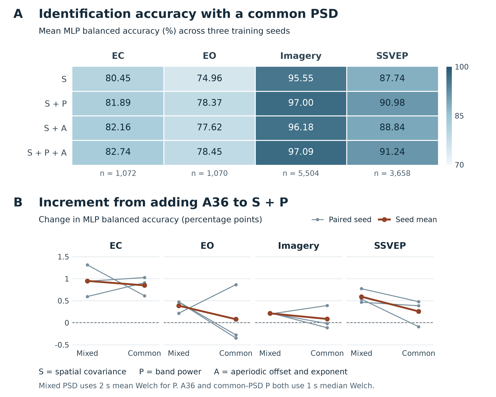

# Ablation Experiment Report

Technical report · Experiments run 19–21 November 2026 · Within-task, closed-set EEG identity recognition

## 1. Scope and data

This experiment measures the change in identification accuracy when explicit aperiodic parameters (A) are added to spatial covariance (S) and band power (P). We evaluated two spectral estimation settings with the same records, splits and training rules.

The cohort contains 11,304 labeled four-second clips from 20 enrolled identities in session 1. Each clip has 1,200 samples × 18 channels at 300 Hz. Inputs use the supplied reference and device-native amplitudes. Each task was trained and scored separately. The unlabeled competition Test set was excluded. Task counts are in the results table.

| Block | Size | Values per clip |
|---|---:|---|
| S | 171 | Weighted upper triangle of the matrix logarithm of the 18-channel covariance after oracle approximating shrinkage (OAS). |
| P | 108 | Log power and relative power for 4–8, 8–13 and 13–30 Hz at each channel. Relative power uses 1–40 Hz as its denominator. |
| A | 36 | One aperiodic offset and one exponent per channel, from fixed-mode FOOOF 1.1.0 fits over 2–40 Hz. |

## 2. Method

| Setting | Implementation |
|---|---|
| Feature conditions | S (171 active inputs), S+P (279), S+A (207), S+P+A (315). S is included in every condition. |
| Mixed PSD | P uses mean Welch power spectral density (PSD) over 2 s segments. A uses median Welch PSD over 1 s segments. Both use periodic Hann windows and 50% overlap. |
| Common PSD | P and A use the same 1 s median Welch spectrum. Recomputing them together for every clip reproduced all training-input P and A values exactly. |
| Splits | Three filename-order blocks per identity and task. For outer fold *f*, block *f* is evaluated, block *(f+1) mod 3* supplies inner development and block *(f+2) mod 3* supplies training. Historical boundary exclusions and a two-rank train–development buffer apply. Each role contains all 20 identities. |
| MLP | 315 → 256 → 128 → 20, with LayerNorm, GELU and dropout 0.2. Median imputation and standardization are fitted on inner-training rows. Disabled blocks are zeroed after scaling. Each arm starts from the same weights and minibatch order for a given fold and seed. |
| Training | AdamW, learning rate 0.0005, weight decay 0.01, batch size 32, maximum 80 epochs. The selected checkpoint minimizes inner-development negative log-likelihood (NLL). Seeds are 20261102, 20261103 and 20261104. |
| Matched LDA | Same training rows and preprocessing as the MLP. The least-squares solver uses automatic shrinkage, equal class priors and only the active columns. Each cell and fold has one deterministic fit. |

Each PSD setting comprises **144 MLP fits and 48 LDA fits**. Within each task and seed, predictions from the three nonoverlapping outer folds are combined before computing balanced accuracy (BA), the mean recall over the 20 identities. The primary effect is **BA(S+P+A) − BA(S+P)** in percentage points (pp). Each MLP difference is calculated within seed, before rounding. [Full settings and effect definitions](docs/09_ablation_methods.md) · [Common-PSD protocol and validation](docs/10_source_audit_and_matched_psd.md)

## 3. Results

**MLP balanced accuracy (%).** Entries are means over three seeds. The S and S+A scores apply to both PSD settings. For all 96 cross-protocol pairs with P disabled, the outer predicted labels and probabilities matched exactly.

| Task | Clips | S | S+A | Mixed S+P | Mixed S+P+A | Common S+P | Common S+P+A |
|---|---:|---:|---:|---:|---:|---:|---:|
| Eyes closed (EC) | 1,072 | 80.45 | 82.16 | 82.66 | 83.61 | 81.89 | 82.74 |
| Eyes open (EO) | 1,070 | 74.96 | 77.62 | 78.65 | 79.04 | 78.37 | 78.45 |
| Imagery | 5,504 | 95.55 | 96.18 | 96.83 | 97.04 | 97.00 | 97.09 |
| SSVEP | 3,658 | 87.74 | 88.84 | 90.99 | 91.59 | 90.98 | 91.24 |

**Increment from A given S+P (pp).** MLP entries are mean ± sample SD across seeds. The positive counts refer to seed-level pooled results. Under mixed PSD, all three seeds were positive in every task.

| Task | Mixed MLP | Common MLP | Common positive seeds | Mixed LDA | Common LDA |
|---|---:|---:|---:|---:|---:|
| EC | +0.950 ± 0.359 | +0.849 ± 0.213 | 3/3 | +1.252 | +0.559 |
| EO | +0.387 ± 0.149 | +0.080 ± 0.680 | 1/3 | +0.271 | +0.640 |
| Imagery | +0.213 ± 0.013 | +0.086 ± 0.269 | 1/3 | +0.229 | +0.288 |
| SSVEP | +0.591 ± 0.161 | +0.258 ± 0.305 | 2/3 | +0.666 | +0.537 |



Panel A shows mean BA. In panel B each thin line follows one seed across PSD settings. Unrounded scores for both classifiers and all eight BA contrasts are available in the repository. [Cell scores](docs/results/ablation/paired_cells.csv) · [Paired contrasts](docs/results/ablation/paired_effects.csv) · [Vector figure](docs/results/ablation/ablation-overview.pdf)

<details>
<summary>Secondary MLP metrics and training checks</summary>

All differences compare S+P+A with S+P. Accuracy and macro-F1 differences are in pp. RBER is the per-seed reduction in balanced error relative to S+P, averaged over seeds. Corrected / regressed counts give the mean number of clips per seed switching from incorrect to correct / correct to incorrect.

| PSD | Task | Δ accuracy (pp) | Δ macro-F1 (pp) | Δ NLL | RBER (%) | Corrected / regressed |
|---|---|---:|---:|---:|---:|---:|
| Mixed | EC | +0.777 | +0.897 | −0.030 | 5.44 | 23.0 / 14.7 |
| Mixed | EO | +0.312 | +0.293 | −0.013 | 1.79 | 21.0 / 17.7 |
| Mixed | Imagery | +0.206 | +0.211 | −0.009 | 6.71 | 33.0 / 21.7 |
| Mixed | SSVEP | +0.565 | +0.584 | −0.019 | 6.65 | 44.3 / 23.7 |
| Common | EC | +0.715 | +0.849 | −0.023 | 4.72 | 21.7 / 14.0 |
| Common | EO | +0.062 | −0.111 | −0.012 | 0.38 | 16.3 / 15.7 |
| Common | Imagery | +0.097 | +0.097 | −0.007 | 3.04 | 27.0 / 21.7 |
| Common | SSVEP | +0.255 | +0.243 | −0.012 | 2.72 | 42.7 / 33.3 |

The MLP reached the 80-epoch cap in 57/144 mixed-PSD fits and 54/144 common-PSD fits. Epoch 80 was the selected checkpoint in 45 and 40 fits, respectively.

</details>

## 4. Interpretation and limits

- Adding A raised mean MLP BA for every task under both PSD settings. Under common PSD, EC was the only task with an increase at every seed. LDA also gained in all four tasks.
- The gain depends on the baseline. In common-PSD EO, adding A to S gained 2.657 pp. Adding A to S+P gained 0.080 pp. P already includes aperiodic background power.
- These measurements apply to the registered identities, one session and filename-block splits. Independent Runs and original window offsets are unknown. Seed SD describes training variation on these records. The [historical LDA benchmark](LDA_EXPERIMENT_REPORT.md) used a larger training pool. The matched LDA in section 3 is the linear control for this experiment.

## 5. Reproduction

**Redraw the figure from the repository.** From the repository root, run the following in an activated Python environment. The script reads the two aggregate CSVs linked above and writes PNG and PDF files in the output directory.

```powershell
python -m pip install -e ".[plots]"
python scripts/ablation/plot_publication_ablation.py --output-dir artifacts/ablation/reproductions/figure
```

**Refit from prepared features.** With the ablation environment installed and the team's prepared EC files available, the following reruns all 36 mixed-PSD MLP fits for EC and writes the pooled report. Choose a fresh output directory for each run.

```powershell
$prepared = 'artifacts/ablation/ec/prepared'
$out = 'artifacts/ablation/reproductions/ec-mlp'
python scripts/ablation/run.py --features "$prepared/features.npz" --splits "$prepared/splits.csv" --task EC --device cpu --output-dir "$out/runs"
if ($LASTEXITCODE -ne 0) { throw "EC training failed" }
python scripts/ablation/summarize.py --input-dir "$out/runs" --output-dir "$out/report"
```

For the recorded environment and inputs, the EC summary should give an `A_given_P` mean of +0.950 pp (seed SD 0.359 pp, rounded). The secondary MLP measures come from the per-task reports under `<task>/full/report/` and the `overview/` tables for each PSD setting.

**Rebuild the features and both experimental runs.** The recorded CPU environment used Python 3.13.17. Data dependencies are specific to the handoff.

| Step | Required local inputs |
|---|---|
| Prepare mixed-PSD features | The periodic handoff with its S/P matrices, feature dictionaries and split assignments, plus `train_basic.h5` (`data_basic`) and `unique_index.csv`. Record IDs, original paths, channel order and labels must align. |
| Prepare common-PSD features | The same HDF5 and index. Under `artifacts/ablation/`, the script reads `ec/prepared/`, `shared/prepared_other_tasks/` and the four completed mixed-PSD MLP run manifests. It checks source, extractor and environment fingerprints. |
| Refit matched LDA and compare protocols | Prepared matrices and splits, completed task-specific MLP runs for the matching protocol, then the corresponding LDA runs and predictions for the cross-protocol comparison. |

The repository contains aggregate BA tables and plotting code. The feature matrices, split files, checkpoints and individual predictions used for fitting are local artifacts. Applying the pipeline to another dataset requires mapping its channel and feature layout, record IDs, enrolled labels and acquisition groups to the expected inputs. [Environment versions](environments/ablation-20261119.txt) · [Setup, four-task training and comparison commands](scripts/ablation/README.md)
