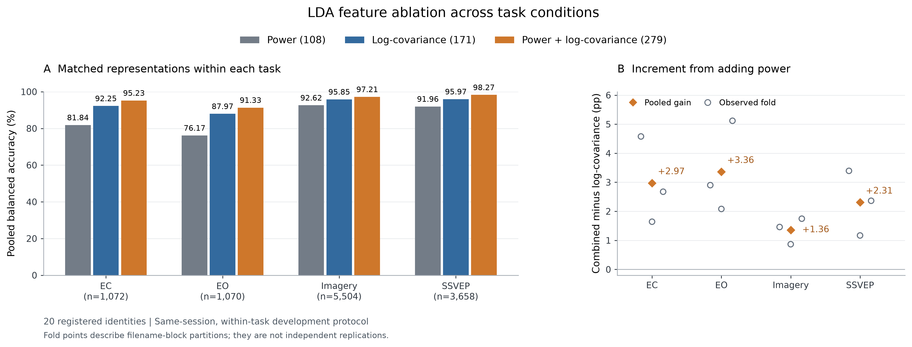
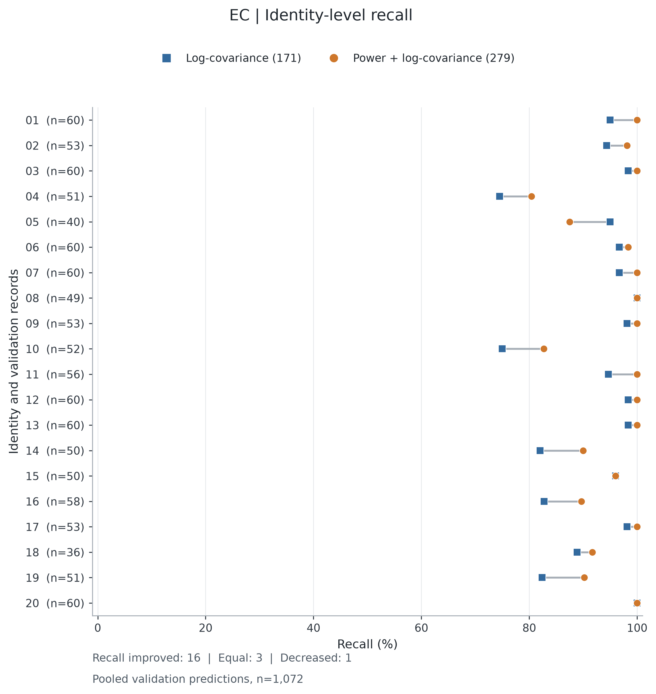

# LDA Experiment Report

**Scope:** power and spatial feature ablation for same-session EEG identity recognition. **Results generated:** 17–18 November 2026 (Asia/Shanghai).

**Research question.** Does band power contribute useful identity information beyond a log-covariance baseline under a fixed linear classifier, and does that contribution recur under different task conditions?

This report consolidates the completed EC, EO, Imagery and SSVEP experiments: **four tasks × three feature representations × three folds = 36 fitted cases**. Adding band power improved pooled balanced accuracy in every task, by **1.36–3.36 percentage points**, with a positive gain in all 12 observed validation folds. These are within-task development results from one labeled session. The experiment establishes a reference representation for the next feature comparison; broader generalization requires separate evaluation.

## Data and feature representations

Each record contains 4 seconds of EEG from 18 channels sampled at 300 Hz, with shape `1200 × 18`. The input view is `data_basic`, retaining the original reference and device-native amplitude units; the reference and physical unit conversion remain unverified. Features come from the frozen `periodic_handoff_20261102` handoff. This experiment refits classifiers using those saved features rather than re-extracting the full EEG collection.

| Representation | Symbol | Definition | Dimension |
|---|---|---|---:|
| `power108` | P | Log10 and relative theta (4–8 Hz), alpha (8–13 Hz) and beta (13–30 Hz) powers across 18 channels | 108 |
| `logcov171` | S | Weighted upper-triangle vectorization of the matrix logarithm of within-record OAS covariance | 171 |
| `power_logcov279` | S+P | Concatenation of the power and log-covariance vectors | 279 |

Band power contains contributions from the aperiodic background, and broadband covariance is a mixed signal statistic. P therefore does not denote an isolated periodic component. Explicit aperiodic parameters are reserved for the next controlled comparison.

## Evaluation protocol

All cases use the frozen `within_task_blocked_provisional` assignments. Every training and validation fold contains the same 20 registered identities. Each task is trained and validated using its own records. Filename blocks and historical boundary exclusions define the partitions; their relationship to independent acquisition Runs, original continuous recordings and overlapping source windows remains unverified.

The pipeline fits median imputation, missing-value indicators and standardization on the training fold, followed by shrinkage LDA with `solver="lsqr"`, `shrinkage="auto"` and equal priors over the 20 identities. These settings are fixed across representations. No model selection or rejection-threshold calibration is performed in this reproduction.

| Task | Fold 0 train / validation | Fold 1 train / validation | Fold 2 train / validation | Pooled validation records |
|---|---:|---:|---:|---:|
| EC | 670 / 362 | 634 / 358 | 680 / 352 | 1,072 |
| EO | 670 / 360 | 633 / 357 | 677 / 353 | 1,070 |
| Imagery | 3,624 / 1,840 | 3,589 / 1,835 | 3,635 / 1,829 | 5,504 |
| SSVEP | 2,392 / 1,226 | 2,357 / 1,221 | 2,407 / 1,211 | 3,658 |

The runner verifies matched validation `(record_id, truth)` sequences, training counts and frozen input hashes across feature groups. Summarization checks nonduplicated validation IDs across folds and recomputes all metrics from the predictions. The four task validation sets are disjoint and together cover **11,304 records**, matching the full labeled Train record set. Record-level agreement does not establish source-window or Run independence.

The primary contrast is **S+P versus S**, and the primary metric is **balanced accuracy**, the mean recall across identities. Accuracy and macro-F1 provide complementary summaries. Each task's overall metrics are recomputed from its pooled validation predictions; they are not simple means of the three fold scores.

## Results

| Task | Representation | Correct / total | Accuracy | Balanced accuracy | Macro-F1 |
|---|---|---:|---:|---:|---:|
| EC | P | 884 / 1,072 | 82.46% | 81.84% | 82.18% |
| EC | S | 992 / 1,072 | 92.54% | 92.25% | 92.66% |
| EC | S+P | 1,025 / 1,072 | **95.62%** | **95.23%** | **95.55%** |
| EO | P | 828 / 1,070 | 77.38% | 76.17% | 76.73% |
| EO | S | 949 / 1,070 | 88.69% | 87.97% | 88.45% |
| EO | S+P | 986 / 1,070 | **92.15%** | **91.33%** | **91.70%** |
| Imagery | P | 5,103 / 5,504 | 92.71% | 92.62% | 92.67% |
| Imagery | S | 5,274 / 5,504 | 95.82% | 95.85% | 95.86% |
| Imagery | S+P | 5,350 / 5,504 | **97.20%** | **97.21%** | **97.21%** |
| SSVEP | P | 3,372 / 3,658 | 92.18% | 91.96% | 92.09% |
| SSVEP | S | 3,517 / 3,658 | 96.15% | 95.97% | 96.11% |
| SSVEP | S+P | 3,599 / 3,658 | **98.39%** | **98.27%** | **98.35%** |

The [machine-readable results](docs/results/lda-within-task-metrics.csv) retain unrounded values. Task conditions differ in training size and data characteristics, so their absolute score differences cannot be attributed to task alone. Results are reported separately by task; a record-weighted aggregate would emphasize the larger Imagery and SSVEP groups.



*Figure 1. Left: balanced accuracy recomputed from pooled validation predictions. Right: the combined-minus-log-covariance gain, with pooled gains shown as orange diamonds and the three observed fold gains as hollow circles. Fold points are descriptive observations, not confidence intervals. A [vector PDF](docs/results/lda-within-task-overview.pdf) is available for export.*

## Fold-level gains

| Task | Pooled BA gain | Fold 0 gain | Fold 1 gain | Fold 2 gain |
|---|---:|---:|---:|---:|
| EC | +2.97 pp | +4.58 pp | +1.64 pp | +2.68 pp |
| EO | +3.36 pp | +2.90 pp | +2.08 pp | +5.12 pp |
| Imagery | +1.36 pp | +1.46 pp | +0.87 pp | +1.75 pp |
| SSVEP | +2.31 pp | +3.39 pp | +1.17 pp | +2.36 pp |

All gains are S+P minus S, calculated before rounding. The positive direction recurs across all task conditions and folds. Fold 1 has the highest balanced accuracy for all three representations in every task. This is an observed partition pattern; the available metadata do not establish its cause. The folds share identities and overlapping training data; their variation alone cannot establish statistical significance or independent replication.

## Paired errors and identity variation

The following counts compare S and S+P on exactly the same validation records. “Corrected” means incorrect under S and correct under S+P; “regressed” means the reverse.

| Task | Both correct | Corrected | Regressed | Both incorrect | Errors: S → S+P |
|---|---:|---:|---:|---:|---:|
| EC | 985 | 40 | 7 | 40 | 80 → 47 |
| EO | 939 | 47 | 10 | 74 | 121 → 84 |
| Imagery | 5,244 | 106 | 30 | 124 | 230 → 154 |
| SSVEP | 3,506 | 93 | 11 | 48 | 141 → 59 |

The corresponding net gains are 33, 37, 76 and 82 correct predictions. Aggregate improvement is accompanied by identity-specific regressions:

| Task | Identities with higher recall | Equal recall | Lower recall |
|---|---:|---:|---:|
| EC | 16 | 3 | 1 |
| EO | 12 | 4 | 4 |
| Imagery | 15 | 2 | 3 |
| SSVEP | 13 | 6 | 1 |

For EC, identity 05 falls from **38/40 (95.0%)** to **35/40 (87.5%)** correct; all five S+P errors are assigned to identity 19. The largest directional EC confusion is identity 10 to 16, involving six records. In Imagery, identity 19 falls from **237/278 (85.25%)** to **223/278 (80.22%)** correct, despite the pooled gain. These cases motivate checking feature quality and error patterns before interpreting improvement as uniform across people.



*Figure 2. An example of the identity-level analysis retained for every task. EC identity 05 shows a regression alongside the aggregate improvement.*

## Interpretation and evidence boundary

The repeated gains support using **power plus log-covariance as the stronger linear reference representation** for subsequent feature comparisons in this development protocol. They suggest complementary predictive information under the fixed LDA model. This experiment does not establish that every identity benefits or that the information is exclusively neural in origin.

These are reproductions of a previously inspected same-session development protocol. Separate training within each task evaluates the recurrence of a feature benefit under different task conditions. Cross-task transfer requires training on one set of tasks and evaluating another; cross-session stability requires independently labeled sessions. Neither is established here. Device, reference, amplitude, source-recording and artifact confounds have not been excluded by this comparison.

The present results also do not measure explicit aperiodic-feature increments, neural-model gains, graph propagation, open-set rejection or attack resistance. No statistical-significance claim is made. Reliable uncertainty estimates require a justified sampling unit and adequate independent acquisition/source groups.

## Result files and provenance

The complete local LDA collection is organized under `artifacts/lda/`:

```text
artifacts/lda/
  runs/{ec,eo,imagery,ssvep}/       # Nine fold JSON files and a summary per task
  reports/{ec,eo,imagery,ssvep}/    # Aggregate CSVs, PNG/PDF figures and provenance
  overview/                       # Four-task metrics and overview figure
  learning/                       # Earlier single-fold learning runs
  demo/                           # Synthetic demonstration result
  README.md                       # Local collection index
  migration_manifest.json         # Original/new paths, byte sizes and SHA256
```

All 100 pre-existing LDA artifact files were relocated without changing their byte sizes or SHA256 hashes. The earlier learning runs repeat part of the real-data baseline, and the synthetic example checks engineering connectivity. They are not additional independent evidence beyond the 36 real-data fitted cases summarized above. Per-record predictions remain in the Git-ignored local artifact collection. The repository includes aggregate tables and figures separately:

| Task | Aggregate tables, figures and source hashes |
|---|---|
| EC | [Result directory](docs/results/lda-ec-within-task/README.md) · [Provenance](docs/results/lda-ec-within-task/provenance.json) |
| EO | [Result directory](docs/results/lda-eo-within-task/README.md) · [Provenance](docs/results/lda-eo-within-task/provenance.json) |
| Imagery | [Result directory](docs/results/lda-imagery-within-task/README.md) · [Provenance](docs/results/lda-imagery-within-task/provenance.json) |
| SSVEP | [Result directory](docs/results/lda-ssvep-within-task/README.md) · [Provenance](docs/results/lda-ssvep-within-task/provenance.json) |

EC fits were generated on 17 November 2026; the remaining task fits and all task reports were generated on 18 November. All 36 cases match their historical accuracy, balanced accuracy and macro-F1 within `1e-12`. The manifests record source-result hashes, feature/dictionary/split hashes, environment versions and the summary-generator hash. Reorganizing the files preserves the saved predictions and numeric results.

The recorded fitting environment used Python 3.13.17, NumPy 2.5.5, SciPy 1.18.1 and scikit-learn 1.9.1. Figures used Matplotlib 3.11.2. The feature handoff must be obtained separately; raw EEG, feature matrices and model checkpoints are not included in these report directories. Data-use and redistribution permissions remain to be confirmed.

## Reproduce the four-task comparison

From the repository root, install the package in a virtual environment. Set `$handoff` to the directory containing the separately obtained handoff's `payload/` and `handoff_manifest.json`, and choose a fresh reproduction directory:

```powershell
.\.venv\Scripts\python.exe -m pip install -e ".[plots]"
$handoff = 'PATH_TO_PERIODIC_HANDOFF'
$runRoot = 'artifacts/lda/reproductions'
foreach ($task in @('EC', 'EO', 'Imagery', 'SSVEP')) {
    $slug = $task.ToLowerInvariant()
    .\.venv\Scripts\python.exe scripts/run_lda_ablation.py --package-root $handoff --task $task --output-dir "$runRoot/$slug/runs"
    if ($LASTEXITCODE -ne 0) { throw "LDA $task failed" }
    .\.venv\Scripts\python.exe scripts/summarize_lda_results.py --input-dir "$runRoot/$slug/runs" --output-dir "$runRoot/$slug/report"
    if ($LASTEXITCODE -ne 0) { throw "Report $task failed" }
}
```

`--fold` optionally selects a single fold; `--task` defaults to EC. The summary script processes one task at a time, verifies prediction/metadata consistency and exports aggregate tables and three PNG/PDF figure pairs. `--skip-plots` produces tables only. Use new output directories to preserve previous runs.

Regenerate Figure 1 from the versioned aggregate CSV tables with the [overview plotting script](scripts/plot_lda_overview.py), using a fresh local output prefix:

```powershell
.\.venv\Scripts\python.exe scripts/plot_lda_overview.py --results-dir docs/results --output-prefix artifacts/lda/reproductions/overview-check/lda-overview
```

## Next comparison

Align the 36 aperiodic parameters, comprising offset and exponent for each channel, with the frozen record keys and feature definitions. Compare **S / S+P / S+A / S+P+A** at dimensions **171 / 279 / 207 / 315**, with the primary aperiodic contrast being **315 versus 279**. Fit-quality and missingness checks precede identity classification, and all learned transforms remain training-only.

Confirm source-recording groups and independent session labels in parallel. After establishing the feature comparison, use matched inputs and partitions for LDA-versus-MLP experiments; assess graph structure with controls for connectivity features and model capacity.
