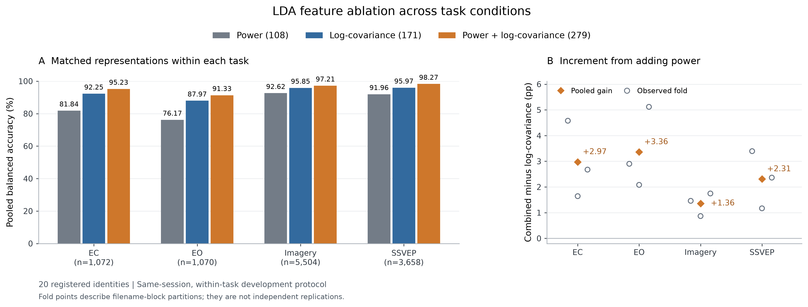

# Spectral Brainprint

**融合周期、非周期与空间统计特征的可解释EEG神经指纹识别框架。**

当前是从竞赛脚本向可复现研究软件迁移的早期仓库。已迁入功率、空间与盲谱计算、交接包读取和对齐、固定 LDA 单案例复现、团队 MLP20 的融合特征读取与冻结阈值推理。融合网络、ResMLP 和原始波形 CNN 已迁入模型定义。真实 MLP20 推理需要交接版对应的权重和校准文件。非周期波形提取与图模型属于后续接入范围。

项目首先回答：非周期参数是否在功率和空间基线之外提供身份信息，以及这种增益能否跨任务、记录组和扰动条件保持。深度阶段描述为“结合谱参数化先验与深度表示学习的EEG神经指纹识别算法”；收益与复杂度均须通过实验验证。

## LDA 实验结果

已完成 EC、EO、Imagery、SSVEP 四任务的三组特征、三折验证，共 **36 次 LDA 训练**。每个任务分别在自己的记录上训练和验证，20 个注册身份均在训练中出现；填补与标准化只在训练折拟合。下面是合并不重复验证预测得到的平衡准确率。

| 任务 | 验证记录 | 功率108 | 协方差171 | 合用279 | 合用相对协方差 |
|---|---:|---:|---:|---:|---:|
| EC | 1,072 | 81.84% | 92.25% | 95.23% | +2.97 pp |
| EO | 1,070 | 76.17% | 87.97% | 91.33% | +3.36 pp |
| Imagery | 5,504 | 92.62% | 95.85% | 97.21% | +1.36 pp |
| SSVEP | 3,658 | 91.96% | 95.97% | 98.27% | +2.31 pp |



*左图为各任务的合并平衡准确率；右图区分合并预测计算的功率增益与三个实际验证折的增益。逐折点描述当前分块结果，不是置信区间。任务间训练样本量不同。*

四任务、十二个验证折的功率增益方向均为正，逐身份结果也存在回退。当前证据支持功率与空间统计在**同会话、任务内开发协议**下的互补性；跨任务迁移、跨会话稳定性、非周期增益与深度模型效果各需后续实验。

英文 [LDA Experiment Report](LDA_EXPERIMENT_REPORT.md) 统一记录实验设置、全部指标、逐折变化、配对错误、逐身份分析、图表、来源与复现命令。CSV 和各任务图表保存在 `docs/results/`，本地逐次结果集中在被 Git 忽略的目录：

```text
artifacts/lda/
  runs/{ec,eo,imagery,ssvep}/       每任务九个 JSON 与逐折汇总
  reports/{ec,eo,imagery,ssvep}/    各任务表格、PNG/PDF 和 provenance
  overview/                       四任务指标与总览图
  learning/                       早期 EC 第 0 折手工练习
  demo/                           合成示例，验证工程流程
  README.md                       本地目录索引
  migration_manifest.json         已移动文件的原路径、新路径与 SHA256
```

复现时用 `scripts/run_lda_ablation.py` 的 `--task` 选择 `EC`、`EO`、`Imagery` 或 `SSVEP`（默认 EC），再用 `scripts/summarize_lda_results.py` 汇总。每次选择新的输出目录；完整命令见报告。移动文件保留了全部原始内容和来源清单，运行产物继续由 `.gitignore` 排除。

## 从这里开始

- [项目定位与证据边界](docs/01_positioning.md)：研究目标、交付对象、应用边界。
- [转化路线与验收条件](docs/02_roadmap.md)：近期行动、阶段依赖与完成标准。
- [仓库架构与迁移规则](docs/03_repository.md)：目录职责、代码去向与发布规则。
- [已有资产审计](docs/04_asset_audit.md)及[逐文件清单](docs/code_inventory.csv)：本地材料实际支持什么。
- [数据与模型契约](docs/05_contracts.md)：给非周期分支、学长的统一接口。
- [实验协议](docs/06_experiments.md)：基线、增量比较、拒识与抗扰。
- [本次验证记录](docs/07_validation.md)：本次实际执行情况，不等同于历史报告。
- [团队模型接入和下一轮实验](docs/08_team_model_integration.md)包含 MLP20 运行命令、功率与非周期消融设计，以及图模型和 GitHub 发布顺序。

## 本地起步

使用独立环境。最低Python 3.10；已验证版本见 `environments/validated-current.txt`。`environments/legacy-requirements.txt` 是原交接包环境记录，不代表本机已经恢复该环境。

```powershell
python -m venv .venv
.\.venv\Scripts\python -m pip install -e .
.\.venv\Scripts\python -m unittest discover -s tests -v
.\.venv\Scripts\python -m spectral_brainprint demo --output artifacts/lda/demo/demo-rerun.json
```

模拟流程只验证工程连通性，输出不用于证明真实脑纹准确率。读取已有交接包时，显式提供 `--package-root`，该值为包含 `handoff_manifest.json` 与 `payload/` 的目录。先复现一个案例：

```powershell
python -m spectral_brainprint reproduce --package-root "<交接包目录>" --feature-set power108 --protocol within_task_blocked_provisional --task EC --fold 0 --output artifacts/lda/learning/ec-fold0-rerun.json
```

此入口只用已有Train特征，校验索引/列定义、检查训练验证记录和身份，再在训练折拟合填补、标准化与LDA，并与历史同一案例的指标比较。它不训练最终团队模型，也不校准拒识阈值。

## 当前证据

本地交接包包含11,304条Train、22,251条无身份真值Test，四任务，18通道、300 Hz、每段4秒。Train均为session1；文件编号分块未经确认对应真实Run/时间。历史28案例属于探索性同会话协议，不能写成跨会话验证、官方攻击成绩或成熟身份认证系统。

默认输入保持 `data_basic`、原参考、未核实原生幅值单位。带通功率包含周期和非周期成分；宽带协方差是混合统计。可解释特征不自动意味着纯脑源、因果解释或排除设备/伪迹混杂。

## 资料管理

`local/` 保存本次本地源码快照和核验记录，已被Git忽略；其中历史脚本可能含原机路径。原始MAT、H5和NPZ保持在原资料目录，通过显式路径读取。发布候选仅包含已整理的包、配置、合成示例和文档。当前没有选定开源许可证或声明原代码作者；应在贡献归属和数据授权核实后决定。不要把包含 `local/` 的整个本地工作目录直接公开。
