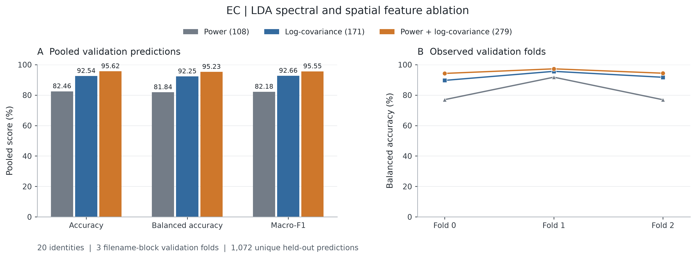
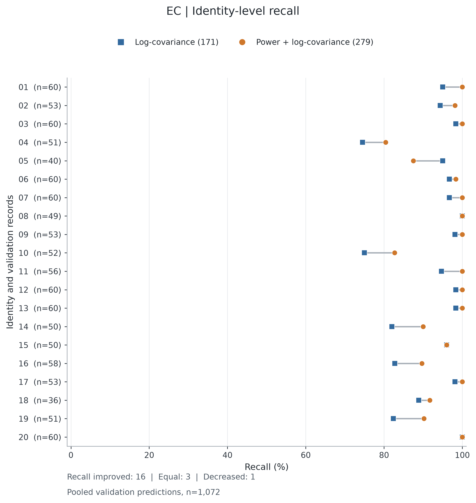

# Experiment Note 01 Power and Spatial Feature Ablation with LDA

**Research question.** Does band power improve EEG identity recognition beyond a log-covariance baseline under a fixed linear classifier and matched data partitions?

In the eyes-closed (EC) same-session development protocol, adding 108 band-power features to 171 log-covariance features increased pooled balanced accuracy from **92.25% to 95.23%**. All three validation folds showed a positive gain. This note records the completed baseline reproduction and the identity-level variation behind that aggregate result.

## Experimental setup

Each EEG record contains 4 seconds of 18-channel data sampled at 300 Hz, with shape `1200 × 18`. The input view is `data_basic`, retaining the original reference and device-native amplitude units. Features come from the frozen `periodic_handoff_20261102` handoff.

| Representation | Features | Dimension |
|---|---|---:|
| `power108` | Log10 and relative band powers for theta, alpha and beta across 18 channels | 108 |
| `logcov171` | Vectorized matrix logarithm of the within-record OAS covariance | 171 |
| `power_logcov279` | Concatenation of power and log-covariance features | 279 |

All representations use the same records and the frozen `within_task_blocked_provisional` assignments. The EC experiment contains 20 registered identities from one labeled session. Records are partitioned by filename blocks, with boundary exclusion defined in the historical protocol. Their relationship to independent acquisition Runs or recording times remains unverified.

| Fold | Training records | Validation records |
|---|---:|---:|
| 0 | 670 | 362 |
| 1 | 634 | 358 |
| 2 | 680 | 352 |

The classifier is shrinkage linear discriminant analysis (LDA), using `solver="lsqr"`, `shrinkage="auto"` and equal priors over the 20 identities. Median imputation, missing-value indicators and standardization are fitted within each training fold. The classifier settings are fixed across feature groups.

The primary comparison is `power_logcov279` versus `logcov171`. Balanced accuracy is the mean recall across identities. Accuracy and macro-F1 provide complementary summaries. Overall scores are computed from **1,072 pooled, nonduplicated validation predictions**. The batch runner checks within-fold record and label alignment, and the summary script verifies that validation records are disjoint across folds.

## Results

| Representation | Correct / total | Accuracy | Balanced accuracy | Macro-F1 |
|---|---:|---:|---:|---:|
| Power | 884 / 1,072 | 82.46% | 81.84% | 82.18% |
| Log-covariance | 992 / 1,072 | 92.54% | 92.25% | 92.66% |
| Power + log-covariance | 1,025 / 1,072 | **95.62%** | **95.23%** | **95.55%** |

Adding power to log-covariance improved pooled balanced accuracy by **2.97 percentage points**. Fold-level gains varied from **1.64 to 4.58 percentage points**, with the same direction in every fold.

| Fold | Power | Log-covariance | Combined | Combined minus log-covariance |
|---|---:|---:|---:|---:|
| 0 | 77.02% | 89.67% | 94.24% | +4.58 pp |
| 1 | 91.76% | 95.60% | 97.25% | +1.64 pp |
| 2 | 76.95% | 91.70% | 94.38% | +2.68 pp |



*Figure 1. Fixed-LDA feature comparison for EC. The left panel summarizes pooled validation predictions. The right panel shows each observed validation fold. Fold variation describes the filename-block partitions used in this development experiment.*

## Error analysis

Comparing the two representations on the same validation records reveals both gains and regressions.

| Log-covariance prediction | Combined prediction | Records |
|---|---|---:|
| Correct | Correct | 985 |
| Incorrect | Correct | 40 |
| Correct | Incorrect | 7 |
| Incorrect | Incorrect | 40 |

The combined representation therefore gained **33 correct predictions**, reducing the error count from 80 to 47. Recall improved for 16 identities, stayed equal for three and decreased for one. Identity 05 fell from **38/40 (95.0%)** to **35/40 (87.5%)** correct. Its five errors under the combined model were all assigned to identity 19.



*Figure 2. Paired identity-level recall for log-covariance and the combined representation, with validation support shown for each identity. The decrease for identity 05 remains visible alongside the aggregate improvement.*

The combined model's largest directional confusion was identity 10 to identity 16, involving six records. The full [confusion matrix](docs/results/lda-ec-within-task/lda_confusion.png) and [per-identity table](docs/results/lda-ec-within-task/per_identity.csv) support further inspection of these errors.

## Interpretation and scope

The results support using power and log-covariance jointly as a stronger linear baseline in the current EC protocol. The positive paired gains suggest that power contributes useful predictive information beyond this spatial representation. The identity-level regressions show that this contribution varies across participants.

This is a reproduction of a historical same-session development protocol whose results have already been inspected. Claims about robustness across tasks, acquisition Runs or sessions require additional evaluation. The three folds share a dataset and overlapping training records, so their variation alone cannot establish statistical significance or independent replication.

Band power includes contributions from the aperiodic background. A direct comparison between 279-dimensional power-plus-spatial features and an otherwise matched representation augmented with explicit aperiodic parameters is needed to assess the latter's incremental value. The present figures evaluate feature representations with LDA. Deep models and graph-based representations have their own planned comparisons.

## Reproduction and provenance

The batch results were generated on 17 November 2026 and summarized on 18 November 2026 (Asia/Shanghai). All nine runs matched their historical accuracy, balanced accuracy and macro-F1 values within the configured `1e-12` tolerance. The recorded run environment used Python 3.13.17, NumPy 2.5.5, SciPy 1.18.1 and scikit-learn 1.9.1. Figures used Matplotlib 3.11.2.

The [provenance manifest](docs/results/lda-ec-within-task/provenance.json) records hashes of the nine source result files, feature files, dictionaries and split assignments, together with environment versions and the summary-generator hash. The scripts and this note are versioned together in the repository update containing this experiment.

From the repository root, install the package in a virtual environment and set `$handoff` to the directory containing the original handoff's `payload/` and `handoff_manifest.json`. Select fresh output directories for each run.

```powershell
.\.venv\Scripts\python.exe -m pip install -e ".[plots]"
$handoff = 'PATH_TO_PERIODIC_HANDOFF'
.\.venv\Scripts\python.exe scripts/run_lda_ablation.py --package-root $handoff --output-dir artifacts/lda-ec-reproduction
.\.venv\Scripts\python.exe scripts/summarize_lda_results.py --input-dir artifacts/lda-ec-reproduction --output-dir artifacts/lda-ec-reproduction-report
```

The [result directory](docs/results/lda-ec-within-task/) includes aggregate CSV tables and PNG/PDF figures. Per-record predictions remain in the local `artifacts/` directory. The input feature handoff must be obtained separately to rerun model fitting.

## Next experiments

1. Repeat the same three-representation comparison for EO, Imagery and SSVEP, preserving the protocol and reporting each task separately.
2. Align the 36-dimensional aperiodic feature matrix (offset and exponent for each of 18 channels) and compare 315-dimensional power-plus-spatial-plus-aperiodic features against the 279-dimensional baseline, using matched records and training-only transforms.
3. Use the resulting feature baseline for controlled LDA-versus-MLP comparisons, then assess graph structure with matched input and capacity controls.
