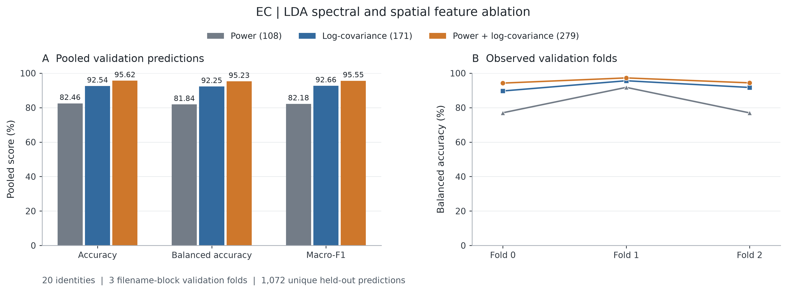
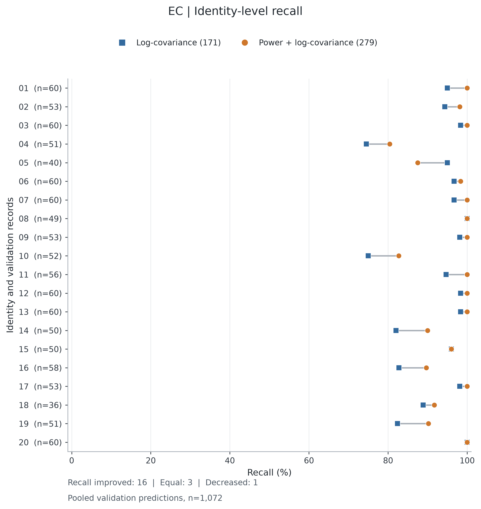
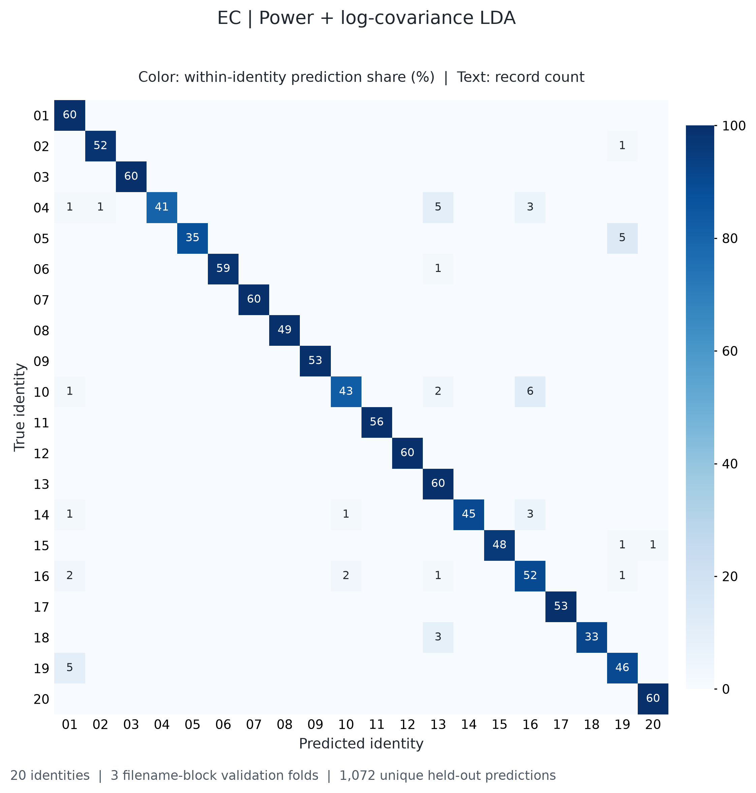

# 闭眼任务 LDA 特征对照

## 实验设置

本报告基于 `within_task_blocked_provisional` 的 EC 任务三折验证预测。20 个注册身份均在相应训练折中出现，共 1,072 条记录各产生一条折外预测。每折训练和验证记录数分别为 670/362、634/358、680/352。文件编号分块尚未被核实为独立 Run 或连续采集时间。

分类管线为训练折中位数填补、训练折标准化、等先验的收缩 LDA。三组分别使用功率 108 维、对数协方差 171 维及其拼接 279 维。新增功率的主要比较为 279 维对 171 维，指标为平衡准确率。

## 性能与折间变化



合并指标由三折不重复的预测重新计算。三折的平衡准确率差值用于描述划分变化，图中展示每个实际观测折。该实验支持当前同会话协议下的功率增量，跨会话与未知身份性能需要各自的评估数据和协议。

## 逐身份召回率



协方差到合用的逐条对照中，985 条两组均正确，40 条由错变对，7 条由对变错，40 条两组均错误。16 个身份的召回率上升、3 个持平、1 个下降。身份 05 从 38/40 降到 35/40，其合用模型的 5 个错误均被判为身份 19。该现象是后续按折错误分析的入口。

## 合用模型的混淆矩阵



矩阵每行对应真实身份，每列对应预测身份。颜色表示该行的百分比，单元格文字表示记录条数。合用模型正确 1,025 条、错误 47 条，主要单向混淆包括 10→16 共 6 条，以及 04→13、05→19、19→01 各 5 条。

## 数值与导出

- [总体指标](metrics_summary.csv)包含准确率、平衡准确率与 Macro-F1，数值采用 0–1 的原始比例。
- [逐折指标](fold_metrics.csv)保留各折结果和相对协方差的百分点差值。
- [逐身份结果](per_identity.csv)保留 support、precision、recall 和 F1。
- [配对纠错统计](paired_errors.csv)记录两组逐条预测的四种正确性组合。
- 三组 `confusion_*.csv` 为原始计数矩阵。[provenance.json](provenance.json)记录源文件哈希、模型输入哈希、环境与汇总计算约定。
- 三张图各有 300 dpi PNG 与矢量 PDF。[性能图 PDF](lda_performance.pdf)、[召回率图 PDF](lda_identity_recall.pdf)、[混淆矩阵 PDF](lda_confusion.pdf)可用于进一步排版。

## 复现

在仓库根目录执行以下命令，将输出写入一个新的目录。输入为已有 JSON，汇总阶段读取并分析现有预测。

```powershell
.\.venv\Scripts\python.exe -m pip install -e ".[plots]"
.\.venv\Scripts\python.exe scripts/summarize_lda_results.py --input-dir artifacts/lda-ec-all-folds --output-dir artifacts/lda-ec-report
```

图表展示的研究范围为已注册身份的同会话开发实验。非周期特征、深度模型增益与图模型效果分别由后续对照检验。
